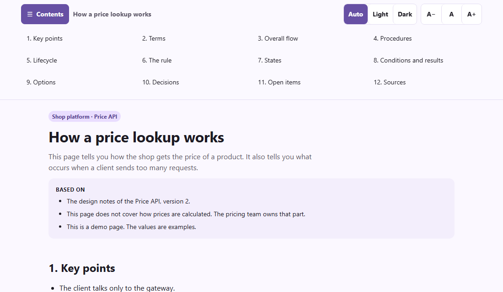
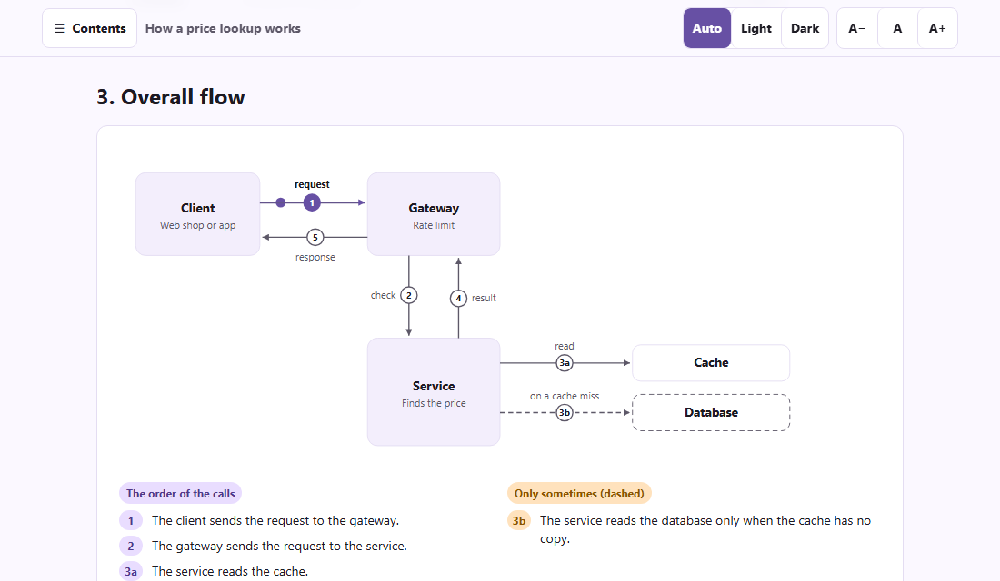
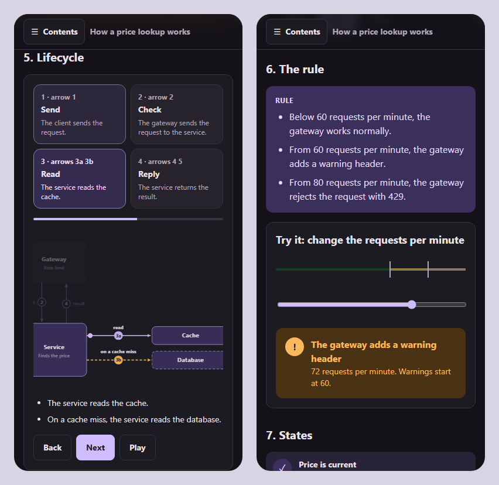

# Agent skills

Skills for AI coding agents (Claude Code, Codex and others that read `SKILL.md`).

## show-me-html

Turns any material into one self-contained HTML document that people understand quickly:
a how-it-works explainer, handbook, runbook, decision record, or a summary of a conversation.

- **Writing**: ASD-STE100 Simplified Technical English. One idea per sentence, numbered steps,
  one term for one thing, preconditions and cautions in their own boxes. Chinese rules included.
- **Pictures that explain order**: flow diagrams with numbered arrows and a dot that runs the
  calls in sequence; a step-through that highlights the parts of each stage; interactive demos
  of the one rule that readers get wrong.
- **Honest scope**: every page opens with a "Based on" box that lists its sources and what it
  does not cover.
- **Reader controls**: a page bar with a contents menu, light / dark / auto theme and text size
  from 87.5 % to 150 %. It hides while you scroll down and comes back when you scroll up.
  Phone layout and back to top. No external files: the page works offline.

### What a page looks like

**[Open the live demo →](https://soonnick0123.github.io/agent-skills/demo/price-lookup-demo.html)**
A demo page about a made-up price API. Try the animations, the stepper, the slider, the theme
switch and the text size. The source is [`demo/price-lookup-demo.html`](demo/price-lookup-demo.html).

**Page bar and header**: the contents menu (open here), theme and text size, then the title,
the lead and the "Based on" box.



**Flow diagram**: numbered arrows in call order. A dot runs the calls one after another; dashed
arrows occur only sometimes.



**Phone, dark mode**: the page bar keeps the title and the contents menu; the theme and text
size move into the menu. The stepper highlights the parts of the selected stage, and the slider
shows the result of the rule live.



### Install

```sh
npx skills add Soonnick0123/agent-skills --skill show-me-html
```

Install only for Claude Code, for all your projects:

```sh
npx skills add Soonnick0123/agent-skills --skill show-me-html -a claude-code -g
```

Or copy `skills/show-me-html/` into `~/.claude/skills/` (or `.claude/skills/` in a project).

### Use

Ask the agent to write something up, for example:

- "Write up how our retry logic works as an HTML page, with a diagram."
- "Summarise this conversation into a document."
- 「把這個功能的機制整理成 html 說明文件，用圖示解釋。」

You can also call it by name: `/show-me-html`.

### Files

| File | Purpose |
|---|---|
| `SKILL.md` | The workflow: research, page structure, writing style, design, self-check |
| `references/ste100-rules.md` | The writing rules for English and Chinese, with examples |
| `assets/page-shell.html` | The page skeleton: tokens, theme switch, text size, phone rules |
| `assets/component-reference.html` | Every component with placeholder text, to copy from |

## License

MIT. See [LICENSE](LICENSE).
