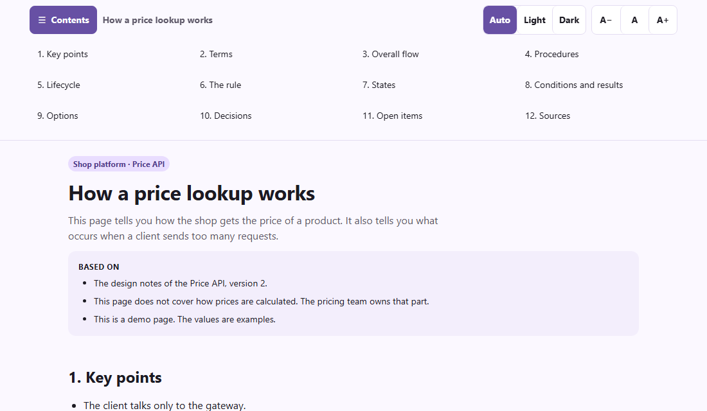
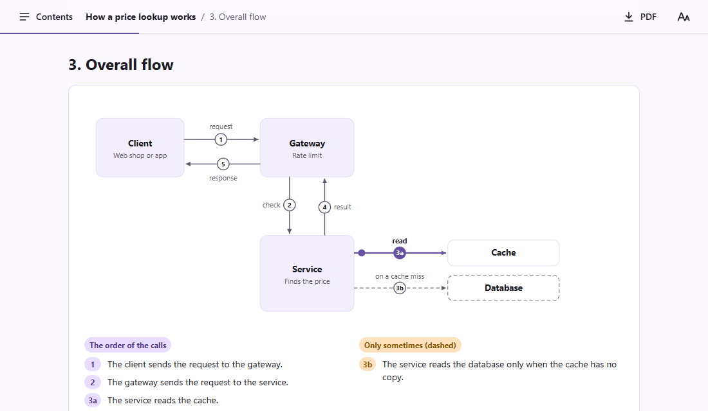
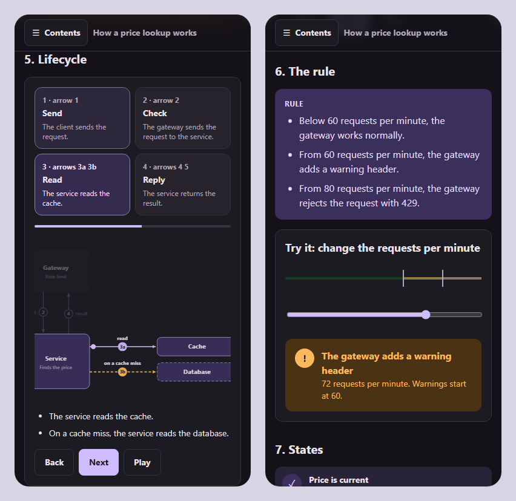
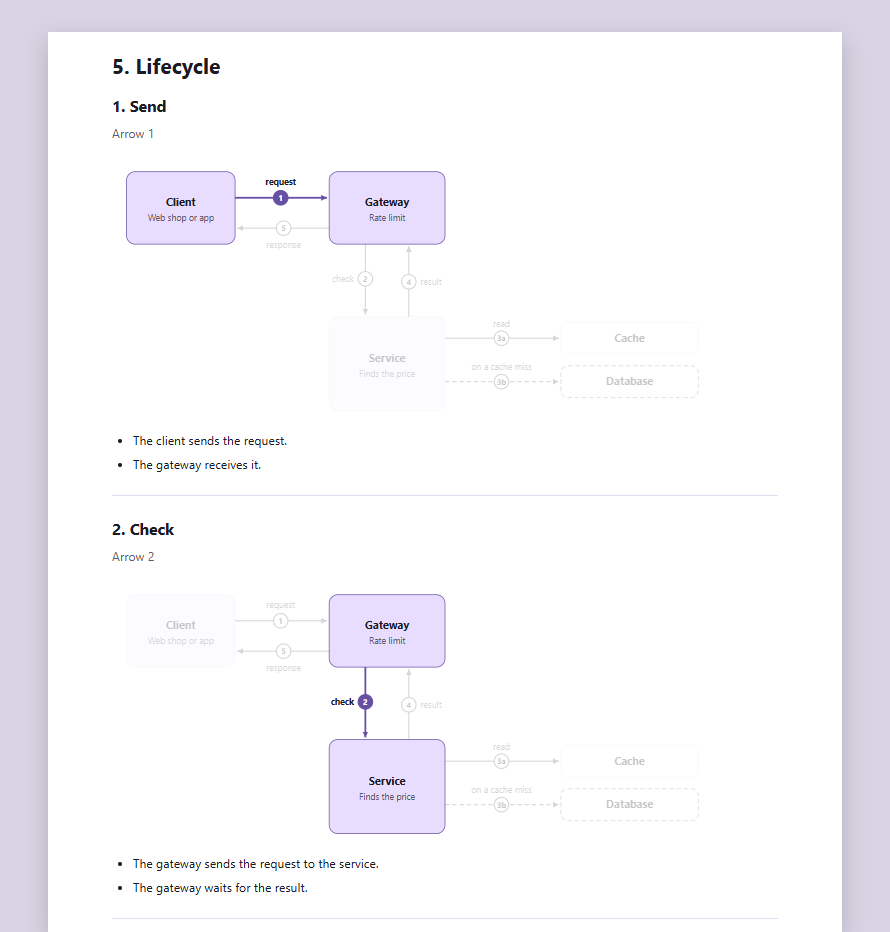

# show-me-html

English | [Traditional Chinese](README.zh-TW.md)

Turns any material into one self-contained HTML document that people understand quickly:
a how-it-works explainer, handbook, runbook, decision record, or a summary of a conversation.

- **Writing**: ASD-STE100 Simplified Technical English. One idea per sentence, numbered steps,
  one term for one thing, preconditions and cautions in their own boxes. Chinese rules included.
- **Pictures that explain order**: flow diagrams with numbered arrows and a dot that runs the
  calls in sequence; a step-through that highlights the parts of each stage; interactive demos
  of the one rule that readers get wrong.
- **Honest scope**: every page opens with a "Based on" box that lists its sources and what it
  does not cover.
- **Reader controls**: a slim page bar that names the section you are in and shows how far you
  have read. On a wide screen the contents stay in a side column; on smaller screens they open
  from the bar. Theme (light / dark / auto) and text size (87.5 % to 150 %) sit behind one "Aa"
  button. On a phone the bar hides while you scroll down and comes back when you scroll up; on
  a desktop it always stays. Each section heading has a "#" link that copies its address.
- **PDF export**: the PDF button says where "Save as PDF" is in the browser's print window,
  then opens it. The print styles remove the bar and the controls, keep the page light, print
  each stepper stage with its own diagram, and keep cards on one page.
- **Phone layout, no external files**: the page works at 360 px wide and offline.
- **Any language**: the content and the interface (bar, menus, PDF help) follow the page
  language. Traditional and Simplified Chinese strings are included.

## What a page looks like

**[Open the live demo →](https://soonnick0123.github.io/agent-skills/demo/price-lookup-demo.html)**
A demo page about a made-up price API. Try the animations, the stepper, the slider, the theme
and text size under "Aa", and the PDF button. The source is [`demo/price-lookup-demo.html`](../../demo/price-lookup-demo.html).

**Desktop**: the contents stay in a side column and mark the section you are in. The bar names
the current section and its bottom edge shows reading progress.



**Flow diagram**: numbered arrows in call order. A dot runs the calls one after another; dashed
arrows occur only sometimes.



**Phone, dark mode**: the page bar names the current section and opens the contents. The
stepper highlights the parts of the selected stage.



**PDF**: each stage of the stepper gets its own diagram with that stage highlighted, followed
by its sentences, so nothing that the screen shows on a click is lost on paper.



## Install

**Claude Code**: run in a terminal, then restart Claude Code.

```sh
claude plugin marketplace add Soonnick0123/agent-skills
claude plugin install show-me-html@soonnick-skills
```

**Other agents (Codex and others)**:

```sh
npx skills add Soonnick0123/agent-skills --skill show-me-html
```

To install every skill at once, see the [main README](../../README.md#install).

## Use

Ask the agent to write something up, for example:

- "Write up how our retry logic works as an HTML page, with a diagram."
- "Summarise this conversation into a document."

You can also call it by name: `/show-me-html`.

## Files

| File | Purpose |
|---|---|
| `SKILL.md` | The workflow: research, page structure, writing style, design, self-check |
| `references/ste100-rules.md` | The writing rules for English and Chinese, with examples |
| `assets/page-shell.html` | The page skeleton: tokens, theme switch, text size, phone rules |
| `assets/component-reference.html` | Every component with placeholder text, to copy from |

## License

MIT. See [LICENSE](../../LICENSE).
