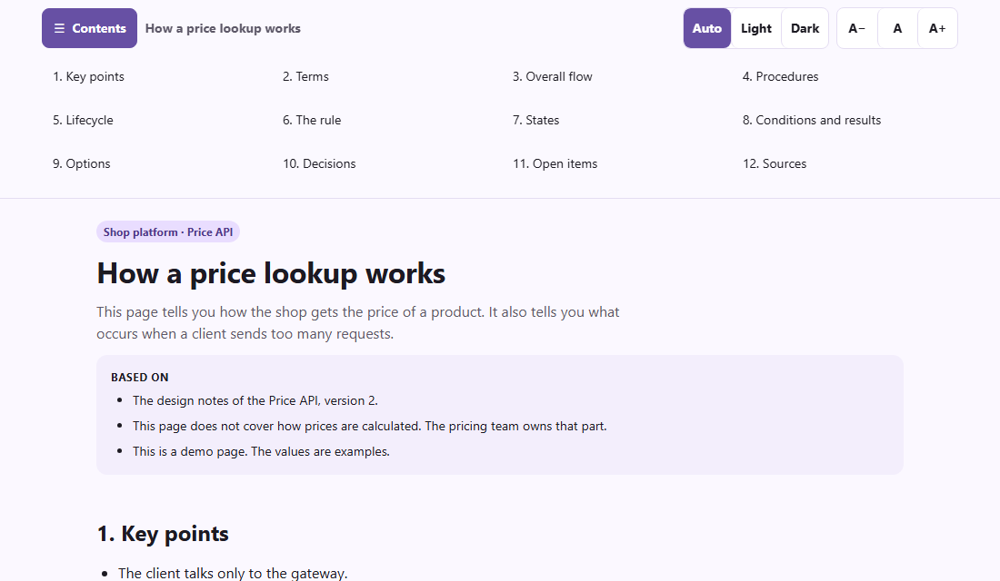
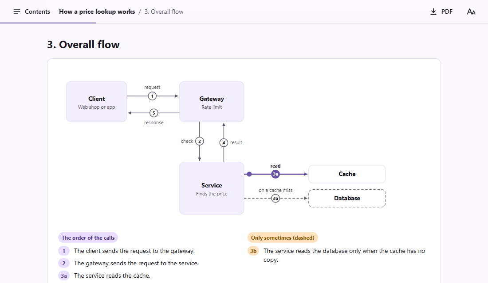
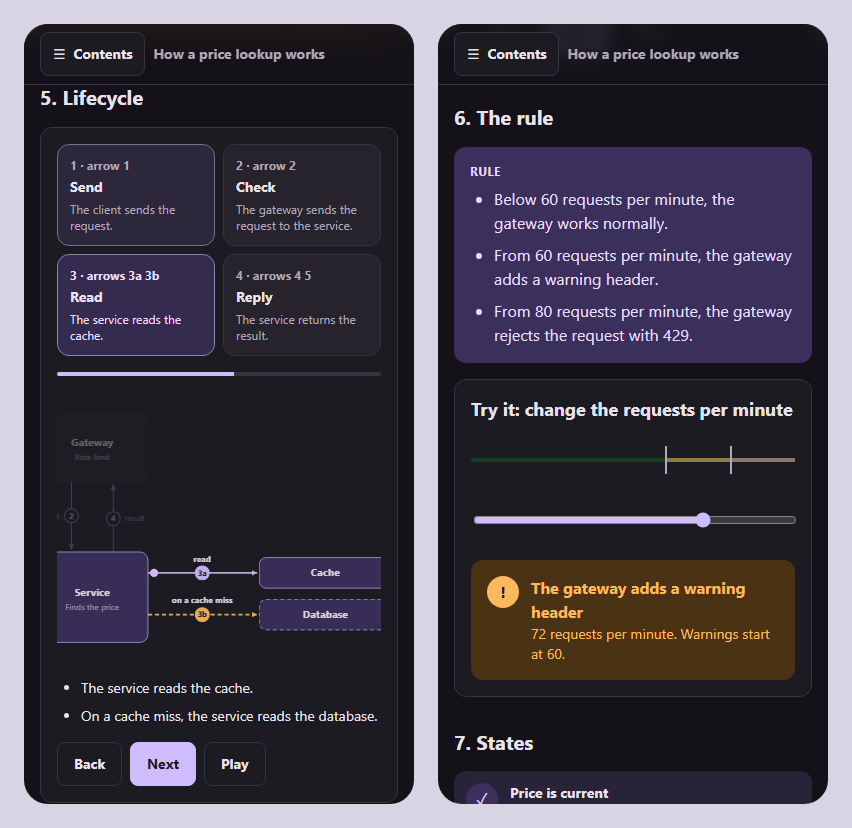
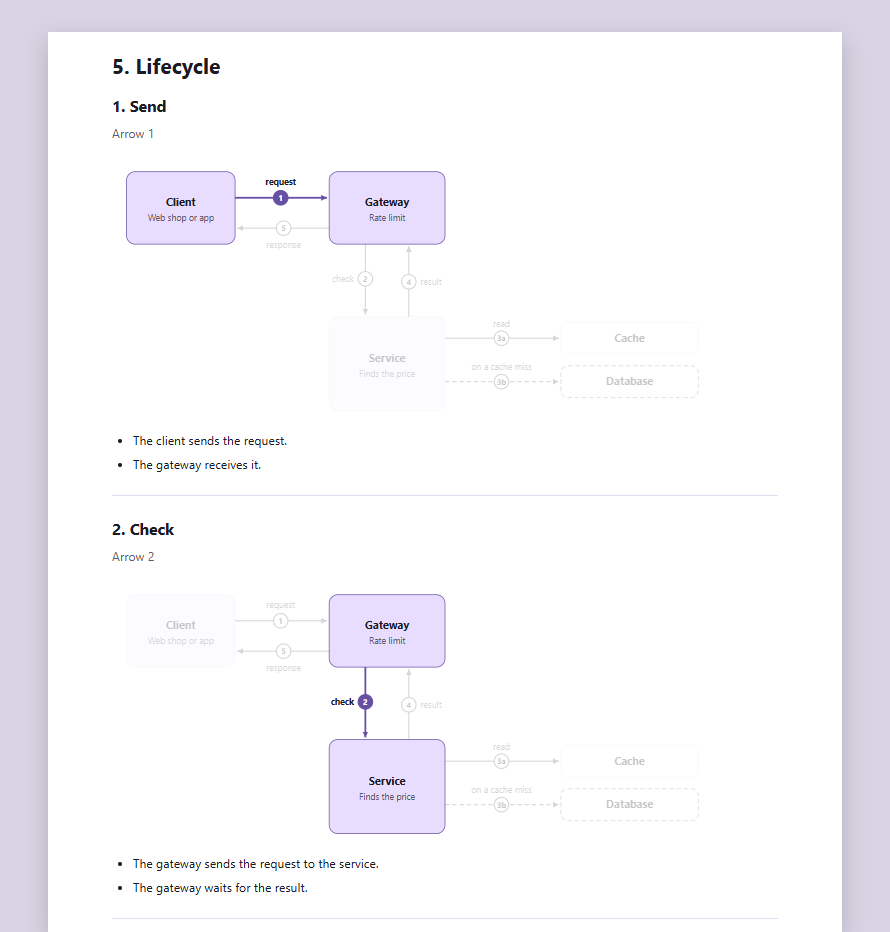

# show-me-html

[English](README.md) | 繁體中文

把任何資料整理成一份獨立的 HTML 文件，讓人很快看懂：機制說明、手冊、runbook、決策記錄，或者一段對話的總結。

- **寫作**：使用 ASD-STE100 簡明技術英語。一句話只講一件事，步驟編號，同一樣東西只用一個名稱，前提條件和注意事項放在各自的框裏。包含中文寫作規則。
- **用圖解釋順序**：流程圖的箭頭按呼叫順序編號，還有一個圓點依次走過每一步；分步驟講解會高亮每個階段涉及的部分；讀者最容易誤解的那條規則，會做成可以互動的示範。
- **清楚說明範圍**：每頁開頭都有一個「資料來源」框，列出依據的資料，以及沒有涵蓋的內容。
- **閱讀控制**：頂部有一條細的頁面列，顯示你目前所在的章節和閱讀進度。寬螢幕上目錄固定在側欄；較小的螢幕上從頁面列打開。主題（淺色／深色／自動）和字體大小（87.5% 到 150%）都放在一個「Aa」按鈕裏。手機上往下捲動時頁面列會隱藏，往上捲動時會再出現；桌面上則一直顯示。每個章節標題都有一個「#」連結，點一下就能複製該章節的網址。
- **PDF 匯出**：按 PDF 按鈕時，會先說明瀏覽器列印視窗裏的「另存為 PDF」在哪裏，然後才打開列印視窗。列印樣式會去掉頁面列和控制按鈕，固定用淺色，分步驟講解的每個階段各印一張圖，卡片也不會被拆到兩頁。
- **適合手機，不依賴外部檔案**：頁面在 360 px 寬的螢幕上也能正常顯示，離線也能用。
- **支援任何語言**：內容和介面（頁面列、選單、PDF 說明）都跟隨頁面的語言。已內建繁體和簡體中文的介面文字。

## 頁面效果

**[打開線上 demo →](https://soonnick0123.github.io/agent-skills/demo/price-lookup-demo.html)**
這是一個介紹虛構價格 API 的示範頁面。可以試試動畫、分步驟講解、滑桿、「Aa」裏的主題和字體大小，以及 PDF 按鈕。原始檔案是 [`demo/price-lookup-demo.html`](../../demo/price-lookup-demo.html)。

**桌面**：目錄固定在側欄，並標示你目前所在的章節。頁面列顯示目前的章節名稱，底邊顯示閱讀進度。



**流程圖**：箭頭按呼叫順序編號。圓點會依次走過每一步；虛線箭頭表示只在某些情況下才會發生。



**手機，深色模式**：頁面列顯示目前的章節名稱，點一下就能打開目錄。分步驟講解會高亮所選階段涉及的部分。



**PDF**：分步驟講解的每個階段各有一張圖，高亮該階段，下面接着該階段的說明。螢幕上要點擊才看到的內容，印出來也不會遺漏。



## 安裝

**Claude Code**：在終端機執行，然後重新啟動 Claude Code。

```sh
claude plugin marketplace add Soonnick0123/agent-skills
claude plugin install show-me-html@soonnick-skills
```

**其他 agent（Codex 等）**：

```sh
npx skills add Soonnick0123/agent-skills --skill show-me-html
```

要一次安裝全部 skill，請看[主 README](../../README.zh-TW.md#安裝)。

## 使用

請 agent 把某些內容寫成文件，例如：

- 「把這個功能的機制整理成 html 說明文件，用圖示解釋。」
- 「把今天討論的東西總結成文件。」
- "Write up how our retry logic works as an HTML page, with a diagram."

也可以直接用名稱呼叫：`/show-me-html`。

## 檔案

| 檔案 | 用途 |
|---|---|
| `SKILL.md` | 工作流程：資料收集、頁面結構、寫作風格、設計、自我檢查 |
| `references/ste100-rules.md` | 英文和中文的寫作規則，附例子 |
| `assets/page-shell.html` | 頁面骨架：design token、主題切換、字體大小、手機版規則 |
| `assets/component-reference.html` | 所有元件，用佔位文字展示，供複製使用 |

## 授權

MIT，詳見 [LICENSE](../../LICENSE)。
